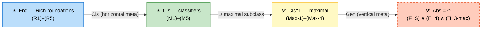

# MSFS — The Moduli Space of Formal Systems

*The Moduli Space of Formal Systems: Classification, Stabilization, and a No-Go Theorem for Absolute Foundations.*

Max Sereda, 2026 · [Zenodo DOI 10.5281/zenodo.19755781](https://doi.org/10.5281/zenodo.19755781) · 41 pages as initially deposited (`paper-en/zenodo/`); current revision: **`paper-en/msfs-paper.pdf` (41 pages, 1639 LaTeX lines)** and **`paper-ru/msfs-paper-ru.pdf` (45 pages, 1532 LaTeX lines, 1-to-1 Russian edition)** · **68 formal environments** (21 definitions, 7 lemmas, 16 theorems, 8 corollaries, 6 propositions, 8 remarks, 2 conventions; 12 numbered sections, 3 appendices, 36 subsections, 54 bibliography entries, 87 preserved labels) · companion [Verum corpus](./verum-corpus/) with portable kernel-checked representation-level source proof (`proofs/ss-membership/`) and quarantined non-certified schematic stubs (`src/theorems/msfs/`).

## The question this work changes

Instead of asking *which formal system is the single true foundation of mathematics*, MSFS studies the categorical space of coherent foundations and its outer boundary:

> **What is the structure of the space of Rich foundations — which comparisons are unconditional, which require explicit lifting or localization data, and why is an absolute foundation impossible?**

The totality of formal foundations satisfying the Rich-metatheory conditions `(R1)–(R5)` is organized into a $2$-category $\mathcal{F}$ and (modulo Morita/gauge equivalence) a classifying $(\infty, 2)$-stack $\mathfrak{M}$. The paper cleanly separates:
1. **Boundary results (`AFN-T α`, `AFN-T β`, `Dual-AFN-T`)**, proved in $\mathsf{ZFC} + 2\text{-inacc}$ with explicit scope hypotheses (direct/slice-conservative identity mechanism $(\alpha_0)$ across all $\mathrm{R\text{-}S}$, and strong diagonal anti-absoluteness $(\alpha_{\mathrm{diag}})$ under canonical $\Sigma_1$-binumeration and classical or negative-translated relative proof-translation);
2. **Conditional interior comparison criteria** (`thm:meta-mult`, `thm:meta-cat`, `thm:lateral`, `thm:slice-locality`, `thm:ac-oc-duality`, `thm:paraconsistent-afnt`), where exact lifting, faithful embedding, descent, and translation hypotheses are stated explicitly;
3. **Open construction and stabilization obligations** (`thm:reflective`, `thm:meta-stab`, `cor:meta-closure`, `thm:bergner-lurie-stab`, `rem:grading-open`) and **comparative placement** (`thm:subsumption`, motivating analogues rather than strict corollaries).

## Stratified architecture



| Stratum | Conditions | Status in current revision |
|---|---|---|
| $\mathcal{L}_{\mathrm{Fnd}}$ | `(R1)–(R5)` | Populated by $\mathsf{ZFC}$, $\mathsf{PA}$, $\mathsf{MLTT}$, $\mathsf{CIC}$, $\mathsf{HoTT}$, $\mathrm{Eff}$-theory, etc. |
| $\mathcal{L}_{\mathrm{Cls}}$ | `(M1)–(M5)` | Conditional plurality criterion (`thm:meta-mult`) for distinct essential classification images |
| $\mathcal{L}_{\mathrm{Cls}}^{\top}$ | `(Max-1)–(Max-4)` | Conditional biequivalence criterion (`thm:meta-cat`) given common comparison target & hom-equivalences |
| $\mathcal{L}_{\mathrm{Abs}}$ | $(F_S) \wedge (\Pi_{4, S, n}) \wedge (\Pi_{3\text{-max}, S, n})$ | **Empty within the scope of `AFN-T` (`thm:afnt-alpha`)** |

## Summary of principal results

1. **Two-mechanism `AFN-T α` (`thm:afnt-alpha`).** Emptiness of $\mathcal{L}_{\mathrm{Abs}}$ is established by two complementary mechanisms:
   - **Direct / slice-conservative mechanism $(\alpha_0)$**: across all $S \in \mathrm{R\text{-}S}$, when $F = S$ or $\mathrm{Syn}(\iota_F)$ is slice-conservative on $[\phi_X]_F$, Lemma `lem:SS-membership` places $X$ in $\mathcal{S}_S^{\mathrm{local}} \subseteq \mathcal{S}_S$, refuting $(F_S) \wedge (\Pi_{4,S,n})$ via the identity equivalence.
   - **Strong Diagonal Anti-Absoluteness $(\alpha_{\mathrm{diag}})$**: for *arbitrary* faithful subtheory inclusions $\iota_F : F \hookrightarrow S$ (without slice-conservativity and even if $\Pi_4$ is punctured or omitted), under a canonical $\Sigma_1$-binumeration $\sigma_S$ of $S$'s axioms and classical first-order relative interpretability (or an explicit negative translation plus primitive-recursive proof-translation verifiable in $\mathsf{PA}$ for intuitionistic/linear/type-theoretic systems), $(F_S) \wedge (\Pi_{3\text{-max},S,n})$ is refuted by testing against $T_S := \mathsf{PA} + \mathrm{Con}_{\sigma_S}(S) \in \mathcal{F}$ (whose `(R3)` model is standard $\mathbb{N} \in \mathbf{U}_1 \subset \mathbf{U}_2$ via `(R3)` for $S$, without $\omega$-consistency) and applying Gödel–Feferman–Pudlák Second Incompleteness (Feferman 1960; Pudlák 1985).
2. **Transfinite & proper-class `AFN-T β` (`thm:afnt-beta`, `prop:proper-class`).** $\mathbf{U}_2$-cofinal diagrams with explicitly $S$-definable objects and coherent transitions whose colimit exists in $\mathbf{U}_2$ stay inside $\mathcal{S}_S^{\mathrm{global}}$ and fail $\Pi_4$, while arbitrary directed or proper-class towers obey an unconditional excluded-middle dichotomy on the limit object $A_\infty$ (illustrated by the terminal-collapse counterexample showing why diagram uniformity cannot be inferred from colimit definability).
3. **Two-stage `AC/OC` architecture (`sec:ac-oc-duality`, `thm:ac-oc-duality`, `thm:dual-afnt`).**
   - **Stage 1 (pre-localization)**: the section–forgetful adjunction $\varepsilon \dashv \alpha : \mathcal{E} \to \mathcal{F}$ is strictly asymmetric ($\alpha \circ \varepsilon = \mathrm{id}_{\mathcal{F}}$, counit $(\mathrm{id}_F, \iota) : \varepsilon(F) \to E$ distinct from retraction $(\mathrm{id}_F, r) : E \to \varepsilon(F)$, with non-invertible internal reflector unit $\eta_r$ in $\mathcal{E}$).
   - **Stage 2 (post-localization)**: under explicit localization, descent, and coherence hypotheses (Pronk `(BF1)–(BF5)`), inverting reflection morphisms $\mathcal{R}_{\mathcal{E}}$ yields a coarse equivalence $\mathfrak{M} \simeq \mathfrak{M}_{\mathcal{E}}$. Independently of localization, `thm:dual-afnt` establishes $\mathcal{L}_{\mathrm{Abs}}^{\mathcal{E}} = \emptyset$ directly in $\mathcal{E}$ within the scope of `thm:afnt-alpha` (requiring explicit faithful relative interpretations $F \hookrightarrow F' \hookrightarrow S$ in $(\tilde{F}_S)$).
4. **Verified ordinary display slice & grade-zero collapse (`thm:I-existence`, `prop:grading`, `cor:grade-collapse`).** Ordinary slice display categories form a verified contravariant pseudofunctor, while equivalence-seeded display filtrations collapse at grade zero; non-trivial higher intensional refinements (`(I-1)–(I-4)`, citing Kapulkin–Li 2025) are stated as explicit construction obligations.
5. **Paraconsistent conditional transfer (`def:paraconsistent-rs`, `thm:paraconsistent-afnt`).** Formulated with existential non-explosion ($\exists \phi,\, \bot \not\vdash_{S'} \phi$) and explicit boundary-predicate-preserving classical-kernel translation hypotheses.

## Verification & companion formalizations

- **Portable Verum source proof (`verum-corpus/proofs/ss-membership/`)**: ONLY `witness.vr` and `formal.vr` have independently replayed native kernel certificates (certifying the representation-level syntactic-branch union introduction $A \to A \vee B \vee C$ of `lem:SS-membership`, bound byte-for-byte to `paper-en/paper.tex` via `correspondence.json`). All remaining `.vr` files under `verum-corpus/src/theorems/msfs/` and quarantined legacy audit reports in `verum-corpus/audit-reports/` are explicitly documented as non-certified schematic specifications / stubs carrying zero proof-discharge authority (Appendix `app:verification-ledger`).
- **Lean 4 kernel formalization (sibling `math-foundations/lean4-mf-kernel/`)**: zero-`sorry`, zero-axiom, choice-free (`0` `Classical.choice`) constructive formalizations of Strong Diagonal `AFN-T α` (`MathFoundations/Metatheory/StrongAFNT.lean`) and the asymmetric pre-localization adjunction vs coarse localization (`MathFoundations/Metatheory/ReifActAdjunction.lean`).

## Build

```bash
# English edition → paper-en/msfs-paper.pdf
bun scripts/build-paper.ts

# Russian 1-to-1 edition → paper-ru/msfs-paper-ru.pdf
bun scripts/build-paper.ts --paper msfs-ru

# Inventory & correspondence unit tests
python3 verum-corpus/scripts/certification_inventory.py --output verum-corpus/certification-inventory.json
python3 -m unittest discover -s verum-corpus/tests -p 'test_*.py'
```

## Relationship to Diakrisis and Math Foundations

| Programme / Gateway | MSFS Labels |
|---|---|
| `AFN-T α` & `AFN-T β` | `lem:SS-membership`, `thm:afnt-alpha`, `thm:afnt-beta`, `prop:proper-class` (§4–§6) |
| Five-axis analysis | `thm:horizontal`, `thm:vertical`, `thm:meta-vertical`, `thm:lateral`, `thm:completeness` (§7) |
| Display slice & grading | `thm:I-existence`, `thm:slice-locality`, `prop:grading`, `cor:grade-collapse`, `rem:grading-open` (§8) |
| Classifier comparison & open stabilization | `thm:meta-cat`, `thm:meta-mult`, `thm:meta-stab`, `cor:iteration-closure`, `cor:meta-closure` (§9) |
| Two-stage `AC/OC` & `Dual-AFN-T` | `def:enactments`, `thm:ac-oc-duality`, `cor:ac-oc-conservativity`, `thm:dual-afnt` (§10) |

## Licence

- **Paper content** (`paper-en/`, `paper-ru/`): CC BY 4.0 (`LICENSE`).
- **Build & audit scripts** (`scripts/`, `verum-corpus/scripts/`): MIT (`LICENSE` §B).
