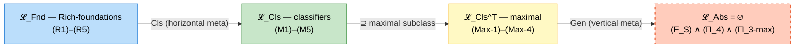

# MSFS — The Moduli Space of Formal Systems

*The Moduli Space of Formal Systems: Classification, Stabilization, and a No-Go Theorem for Absolute Foundations.*

Max Sereda, 2026 · [Zenodo DOI 10.5281/zenodo.19755781](https://doi.org/10.5281/zenodo.19755781) · 41 pages as initially deposited (`paper-en/zenodo/`); current revision: **`paper-en/msfs-paper.pdf` (75 pages, 2,370 LaTeX lines)** and **`paper-ru/msfs-paper-ru.pdf` (82 pages, 2,290 LaTeX lines, 1-to-1 Russian edition)** · **102 formal environments** (25 definitions, 7 lemmas, 33 theorems, 8 corollaries, 13 propositions, 14 remarks, 2 conventions; 12 numbered sections, 3 appendices, 39 subsections, 54 proofs, 6 TikZ figures, 1 practical-domain table, 67 bibliography entries, 128 preserved labels) · companion [Verum corpus](./verum-corpus/) (Wave 1–3: **15** standalone zero-axiom modules, **67** multi-step theorems, **688/688** proved assertions, Track B correspondence proofs `proofs/ss-membership/` + `proofs/afnt-alpha-id/`, and **43** quarantined legacy schematic axioms) and sibling constructive Lean 4 kernel `lean4-mf-kernel` (**107** modules including **32** in `Autogeny/`, **38,316** compiled `.olean` `env.constants` entries [**10,606** in `Autogeny.*`] / **8,550** top-level `.lean` source declarations [**2,213** in `Autogeny/`], **1,454** audited `#print axioms` [**650** in `Autogeny/`], **342** strictly zero-axiom theorems, **227** `NonVacuity` instances across **32/32** `Autogeny/` modules, `0 Classical.choice`).

## The question this work changes

Instead of asking *which formal system is the single true foundation of mathematics*, MSFS studies the categorical space of coherent foundations and its outer boundary:

> **What is the structure of the space of Rich foundations — which comparisons are unconditional, which require explicit lifting or localization data, and why is an absolute foundation impossible?**

The totality of formal foundations satisfying the Rich-metatheory conditions `(R1)–(R5)` is organized into a $2$-category $\mathcal{F}$ and (modulo Morita/gauge equivalence) a classifying $(\infty, 2)$-stack $\mathfrak{M}$. The paper cleanly separates:
1. **Boundary results (`AFN-T α`, `AFN-T β`, `Dual-AFN-T`)**, proved in $\mathsf{ZFC} + 2\text{-inacc}$ with explicit scope hypotheses (direct/slice-conservative identity mechanism $(\alpha_0)$ across all $\mathrm{R\text{-}S}$, and strong diagonal anti-absoluteness $(\alpha_{\mathrm{diag}})$ under canonical $\Sigma_1$-binumeration and classical or negative-translated relative proof-translation);
2. **Conditional interior comparison criteria & `B1–B6` sharp epistemic splits** (`thm:meta-mult`, `thm:meta-cat`, `thm:meta-cat-fib`, `thm:lateral`, `thm:slice-locality`, `thm:ac-oc-duality`, `thm:paraconsistent-afnt`, `thm:I-fragment`, `prop:q2-candidates`, `thm:q3-exhaustiveness-boundary`), where exact proved fragments `[Т]`, conditional criteria `[С]`, obstructions/countermodels `[✗]`, and remaining open barriers `[П]` are separated explicitly;
3. **Open frontier obligations** (`B1`: BSP21/$(\infty,\omega)$ external `(Stab-1)` & moduli bridge `thm:bergner-lurie-stab`; `B2`: universal meta-stabilization `thm:meta-stab`, `cor:meta-closure`; `B3`: full $(\infty,2)$-hyperstack `prob:131T` `(B3-Obs1)–(B3-Obs4)`; `B4`: `(O-AC3)–(O-AC5b)` `rem:oac5-godel-split`; `B5`: global `(I-4)` `rem:I4-isolation`; `B6`: single maximal `Q2` classifier & `(B-Q3.1)–(B-Q3.5)`) and **comparative placement** (`thm:subsumption`).

## Stratified architecture



| Stratum | Conditions | Status in current revision |
|---|---|---|
| $\mathcal{L}_{\mathrm{Fnd}}$ | `(R1)–(R5)` | Populated by $\mathsf{ZFC}$, $\mathsf{PA}$, $\mathsf{MLTT}$, $\mathsf{CIC}$, $\mathsf{HoTT}$, $\mathrm{Eff}$-theory, etc. |
| $\mathcal{L}_{\mathrm{Cls}}$ | `(M1)–(M5)` | Conditional plurality criterion (`thm:meta-mult`) for distinct essential classification images |
| $\mathcal{L}_{\mathrm{Cls}}^{\top}$ | `(Max-1)–(Max-4)` | Conditional biequivalence criterion (`thm:meta-cat`) given common comparison target & hom-equivalences |
| $\mathcal{L}_{\mathrm{Abs}}$ | $(F_S) \wedge (\Pi_{4, S, n}) \wedge (\Pi_{3\text{-max}, S, n})$ | **Empty within the scope of `AFN-T` (`thm:afnt-alpha`)** |

## Summary of principal results

1. **Two-mechanism `AFN-T α` (`thm:afnt-alpha`).** Emptiness of $\mathcal{L}_{\mathrm{Abs}}$ is established by two complementary mechanisms:
   - **Direct / slice-conservative mechanism $(\alpha_0)$**: across all $S \in \mathrm{R\text{-}S}$, when $F = S$ or $\mathrm{Syn}(\iota_F)$ is slice-conservative on $[\phi_X]_F$, Lemma `lem:SS-membership` places $X$ in $\mathcal{S}_S^{\mathrm{local}} \subseteq \mathcal{S}_S$, refuting $(F_S) \wedge (\Pi_{4,S,n})$ via the identity equivalence.
   - **Strong Diagonal Anti-Absoluteness $(\alpha_{\mathrm{diag}})$**: for *arbitrary* faithful subtheory inclusions $\iota_F : F \hookrightarrow S$ (without slice-conservativity and even if $\Pi_4$ is punctured or omitted), under a canonical $\Sigma_1$-binumeration $\sigma_S$ of $S$'s axioms and classical first-order relative interpretability (or an explicit negative translation plus primitive-recursive proof-translation verifiable in $\mathsf{PA}$ for intuitionistic/linear/type-theoretic systems), $(F_S) \wedge (\Pi_{3\text{-max},S,n})$ is refuted by testing against $T_S := \mathsf{PA} + \mathrm{Con}_{\sigma_S}(S) \in \mathcal{F}$ (whose `(R3)` model is standard $\mathbb{N} \in \mathbf{U}_1 \subset \mathbf{U}_2$ via `(R3)` for $S$, without $\omega$-consistency) and applying Gödel–Feferman–Pudlák Second Incompleteness (Feferman 1960; Pudlák 1985).
2. **Transfinite & proper-class `AFN-T β` (`thm:afnt-beta`, `prop:proper-class`).** $\mathbf{U}_2$-cofinal diagrams with explicitly $S$-definable objects and coherent transitions whose colimit exists in $\mathbf{U}_2$ stay inside $\mathcal{S}_S^{\mathrm{global}}$ and fail $\Pi_4$, while arbitrary directed or proper-class towers obey an unconditional excluded-middle dichotomy on the limit object $A_\infty$ (illustrated by the terminal-collapse counterexample showing why diagram uniformity cannot be inferred from colimit definability).
3. **Two-stage `AC/OC` architecture (`sec:ac-oc-duality`, `thm:ac-oc-duality`, `def:o-ac-conditions`, `thm:ac-oc-2cat-loc`, `thm:perf-2cat-obstructions`, `rem:oac5-godel-split`, `thm:dual-afnt`).**
   - **Stage 1 (pre-localization)**: the section–forgetful adjunction $\varepsilon \dashv \alpha : \mathcal{E} \to \mathcal{F}$ is strictly asymmetric ($\alpha \circ \varepsilon = \mathrm{id}_{\mathcal{F}}$, counit $(\mathrm{id}_F, \iota) : \varepsilon(F) \to E$ distinct from retraction $(\mathrm{id}_F, r) : E \to \varepsilon(F)$, with non-invertible internal reflector unit $\eta_r$ in $\mathcal{E}$).
   - **Stage 2 (post-localization & `B4`)**: strict $2$-categorical Pronk span biequivalence for any `CompStrict2Cat` and `BiPushout2Data` `Perf` hold unconditionally (`[Т]`), accessible $(\infty, 1)$-localization and $n=1$ `Perf` hold on $\kappa$-accessible pushout fragments (`[Т]`), while $(\infty, 2)$ saturation/homotopy-pullback lifting is conditional (`[С]`), `CM-1..CM-4b` refute weakening `(BF3)/(BF4)/Perf` (`[✗]`), and `(O-AC5a)` definitional conservativity separates from `(O-AC5b)` Gödel II equiconsistency (`[✗]`/`[П]`). Independently of localization, `thm:dual-afnt` establishes $\mathcal{L}_{\mathrm{Abs}}^{\mathcal{E}} = \emptyset$ directly in $\mathcal{E}$ within the scope of `thm:afnt-alpha`.
4. **Intensional refinement, grading, and `B1–B6` resolutions (`sec:intensional`, `sec:meta`, `sec:bypass-boundary`, `app:categorical`).**
   - **`B1` (`thm:enrichment-noncommutativity`, `thm:cond-infty-stab`, `thm:b1-stab-resolution`, `thm:bergner-lurie-stab`)**: `Alg_cat` commutes with $\mathbb{N}^{\mathrm{op}}$-limits `[Т]` and $\mathrm{Cat}(\mathrm{Cat}_{(\infty,\omega)}^{\mathrm{coind, GH}}) \simeq \mathrm{Cat}_{(\infty,\omega)}^{\mathrm{coind, GH}}$ holds unconditionally `[Т]` (and conditionally for BSP21 `[С]`), whereas `(Stab-2')` for $\mathrm{Cat}_{(\infty,\omega)}^{\tau\text{-}\mathrm{lim}}$ (`2^{\aleph_0} \neq 1$ via $\varprojlim^1$) and $T : \mathrm{Cat}^{\mathrm{coind, GH}} \to \mathrm{Cat}^{\tau\text{-}\mathrm{lim}}$ are refuted `[✗]`.
   - **`B2` (`def:meta-gauge-quotient`, `prop:meta-quotient-finite`, `thm:meta-nonidempotence-obstruction`, `thm:meta-conditional-idem`, `thm:b2-sigma2-bracket`–`thm:b2-finite-rank-nogo`)**: finite-stage quotient `[Т]`, `(M2)/(M3)` obstructions `[Т]`, $\Sigma_2$-reflection consistency bracket strictly below Mahlo `[Т]`, `(Idem-1)–(Idem-4)` realizability & independence `[Т]`, conditional idempotency `[С]`, sharp $n$-stage separation `[Т]`, and unconditional refutation of unstratified finite-rank closure in fixed $\mathbf{U}_n$ `[✗]`.
   - **`B3` (`thm:meta-cat-fib`, `rem:fib-independence`, `rem:grothendieck-intermediate-model`, `prob:131T`)**: `(Fib-1)–(Fib-3)` independence (`NoFib1..NoFib3_faith`), Dual Actica 13-axiom audit, subcanonical sheafification preservation `(B3-Obs2)`, and full $(\infty,2)$-hyperstack problem `131.T` (`(B3-Obs1)–(B3-Obs4)` `[П]`).
   - **`B5` (`def:Sint`, `def:I-fragment`, `thm:I-fragment`, `rem:I4-isolation`, `rem:grading-open`, `prop:resource-grading-model`)**: `thm:I-fragment` closes `(I-1)–(I-3)` on $\mathcal{F}_{\mathsf{MLTT}}$ via directed $2$-cells `(W2)` `[Т]`, `ActCostGrade` (`R-12`) and `Poset2Cat_Z2` (`A4`, $\operatorname{gr}_G(p_{2^{2^n}})=n$) realize non-collapsing gradings `[Т]`, while `(I-4a)–(I-4c)` split into bivariant bridges vs.\ Diamond/strict-pb BC/Option A/`(BF3)–(BF4)` obstructions `[✗]` and global open barriers `[П]`.
   - **`B6` (`prop:q2-candidates`, `thm:q3-exhaustiveness-boundary`, §12 `Q2`–`Q3`)**: `cAsm`/`Eff` non-cocompleteness `[Т]` (`Q2-Cnd.5`), open-ended `Q2` diagonal no-gos `[Т]`/`[✗]` vs.\ bounded relative completeness `[С]`, raw `Q3` overlap `[✗]` + 11-gate precedence partition $\mathcal{T}_8$ `[Т]`, 9th boundary `(B-Q3.5)` `[✗]`/`[П]`, and witnesses ($S_{\Pi_1}$, $\mathcal{D}_3$, $S_\infty(B)$, $\mathbf{B}\mathbb{Z}_2$) `[Т]`.
5. **Paraconsistent conditional transfer (`def:paraconsistent-rs`, `thm:paraconsistent-afnt`).** Formulated with existential non-explosion ($\exists \phi,\, \bot \not\vdash_{S'} \phi$) and explicit boundary-predicate-preserving classical-kernel translation hypotheses.

## Verification & companion formalizations

- **Portable Verum corpus (`verum-corpus/`)**:
  - **Wave 1 + Wave 2 + Wave 3 standalone zero-axiom modules (`src/theorems/msfs/wave{1,2,3}_*.vr`)**: **15** modules, **67** genuine `theorem_multi_step` declarations, **688/688** `verum verify` assertions proved (`158` Wave 1 + `434` Wave 2 + `96` Wave 3: `wave3_certificate_adequacy` [5, `45/45`] and `wave3_left_null_ips` [7, `51/51`]), `15/15` `verum check` PASS, `30/30` `verum arch check --strict` and `verum check --parse-only` PASS across `src/theorems/msfs/*.vr`, and `proof_honesty_gate.sh` PASS (**141** declarations scanned, `0 ensures true`, **43** legacy schematic axioms quarantined).
  - **Track B source correspondence (`proofs/ss-membership/`, `proofs/afnt-alpha-id/`)**: `ss-membership/{witness.vr, formal.vr}` and `afnt-alpha-id/{alpha_zero.vr, lawvere_fp.vr, route1a_retraction.vr}` (`9/9` certificates, `16/16` negative controls rejected, strictly SHA-256 and UTF-8 offset bound to `paper-en/paper.tex` via `verify_wave1_proofs.py --strict-paper-sha`).
- **Lean 4 kernel formalization (sibling `math-foundations/lean4-mf-kernel/`)**: **107** `.lean` modules (**32** in `MathFoundations/Autogeny/` with **32/32** = **100%** `NonVacuity` coverage), **38,316** compiled `.olean` `env.constants` entries (**10,606** in `MathFoundations.Autogeny.*`; **8,550** top-level `.lean` source declarations, **2,213** in `Autogeny/`), **1,454** `#guard_msgs in #print axioms` checks centralized in `MathFoundations/Audit.lean` (**650** in `Autogeny/`), **342** strictly zero-axiom theorems, **227** `NonVacuity` instances (**32/32** `Autogeny/` modules), `0 Classical.choice`, `0 sorry`, `0 admit`, `0 axiom`, `0 unsafe`, `0 extern`, `0 native_decide`, `0 Lean.ofReduceBool`, `0` bare `: Bool` status fields, `0 forbidden_axioms` (`{propext, Quot.sound}` only), including all **15 `B1–B6` Tier I modules** (`EnrichmentTowerB1`, `MetaClassification{Quotient,Separation,Obstructions}`, `ConditionalIdempotenceIndependence`, `MetaCatFibration`, `DualActica13Axioms2Cat`, `SubcanonicalCofinalObstruction`, `Pronk2CatGeneral`, `IntensionalFragmentSeparation`, `StrictVsBicategoricalCollapse`, `VarianceObstructions`, `RealPAOptionACollapse`, `MetaCompletenessQ2`, `Q3BypassPartition`), **12 Wave 3 choice-free modules** (Axes 1–4: `NullConeQGBoundaries` [67], `LeftNullCertificates` [322, incl. sparse `AlgDAGCircuit` compiler `4·nnz(v)-1`], `DyadicIntervalCert` [413, incl. pivoted & invertible SDD congruence], `CertificateAdequacy2Cat` [368]; M2: `CutEliminationHerbrand` [1,576], `AsymptoticCircuitBarriers` [921], `ConstructiveTierILifts` [676], `RealArithGodelCoding` [684]; M3: `ConstructiveC` [356], `PAdicCore` [407], `ModularFormsCore` [360], `ProofMiningCAT0` [247]), and **13 `Autogeny` spine modules** (Axis A-I: `AutReal2` [542], `Autopoiema` [400], `Autoplex` [220], `AutInv` [408]; Axis A-II: `HigherOrderLibrary` [1,167], `DPOSlottedRewriting` [1,225], `AlgebraicOpenSynthesis` [534]; Axis A-III: `NonstationaryTracking` [310], `AdaptiveProofMining` [133], `FloatFreeControlBridge` [255]; Axis A-IV: `HolonSheaf` [303], `CausalAlignmentBridge` [50], `AutogenicLanguage` [495]) alongside `StrongAFNT`, `ReifActAdjunction`, `PronkBicategoryFractions`, `Display2CatGrading`, `Diakrisis13Axioms2Cat`, `FoundationalReconstruction{,V2}`, and `TranslationAdequacy`.

## Build

```bash
# English edition → paper-en/msfs-paper.pdf (75 pages)
bun scripts/build-paper.ts

# Russian 1-to-1 edition → paper-ru/msfs-paper-ru.pdf (82 pages)
bun scripts/build-paper.ts --paper msfs-ru

# Pandoc Markdown export & EN/RU parity verification
PYTHONDONTWRITEBYTECODE=1 python3 -B scripts/build-markdown.py --output-dir output/markdown

# Verum corpus tests, honesty gate & strict paper correspondence
cd verum-corpus
env -u VERUM_STDLIB_PATH PYTHONDONTWRITEBYTECODE=1 python3 -B -m unittest discover -s tests -p 'test_*.py' -v
env -u VERUM_STDLIB_PATH bash tests/integration/proof_honesty_gate.sh
env -u VERUM_STDLIB_PATH PYTHONDONTWRITEBYTECODE=1 python3 -B scripts/verify_wave1_proofs.py --strict-paper-sha
```

## Relationship to Diakrisis and Math Foundations

| Programme / Gateway | MSFS Labels |
|---|---|
| `AFN-T α` & `AFN-T β` | `lem:SS-membership`, `thm:afnt-alpha`, `thm:afnt-beta`, `prop:proper-class` (§4–§6) |
| Five-axis analysis | `thm:horizontal`, `thm:vertical`, `thm:meta-vertical`, `thm:lateral`, `thm:completeness` (§7) |
| Display slice, grading & certificate 2-cats (`B5`, Axes 2 & 4) | `def:Sint`, `def:I-fragment`, `thm:I-existence`, `thm:I-fragment`, `rem:I4-isolation`, `thm:slice-locality`, `prop:grading`, `cor:grade-collapse`, `rem:grading-open`, `prop:resource-grading-model`, `sec:cert-2cat-adequacy`, `thm:cert-sys-2cat-and-sharing`, `thm:left-null-bareiss-ips` (§8) |
| `Q2`/`Q3` completeness (`B6`) | `prop:q2-candidates` (§3), `thm:q3-exhaustiveness-boundary` (§8.3), §12 `(Q2)–(Q3)` |
| Classifier comparison, `131.T` & stabilization (`B2`/`B3`) | `thm:meta-cat`, `prop:max-independence-noncat`, `thm:meta-cat-fib`, `rem:fib-independence`, `rem:grothendieck-intermediate-model`, `prob:131T`, `thm:meta-mult`, `def:meta-gauge-quotient`, `prop:meta-quotient-finite`, `thm:meta-nonidempotence-obstruction`, `thm:meta-conditional-idem`, `thm:b2-sigma2-bracket`–`thm:b2-finite-rank-nogo`, `thm:meta-stab`, `cor:meta-closure` (§9) |
| Two-stage `AC/OC`, conical `Adeq2Cat` & `Dual-AFN-T` (`B4`, `A2`) | `def:enactments`, `thm:ac-oc-duality`, `def:o-ac-conditions`, `prop:ac-oc-accessible-loc`, `thm:ac-oc-2cat-loc`, `prop:perf-noncyclic-bc`, `thm:perf-2cat-obstructions`, `thm:adeq2cat-and-cm-adeq`, `cor:ac-oc-conservativity`, `rem:oac5-godel-split`, `thm:dual-afnt` (§10) |
| $(\infty,\omega)$-enrichment (`B1`) & ledger | `thm:enrichment-noncommutativity`, `thm:cond-infty-stab`, `thm:b1-stab-resolution`, `thm:bergner-lurie-stab` (App. A.8), `app:verification-ledger` (App. C) |

Downstream integration of these categorical, resource-grading, and proof-theoretic foundations into autogenic systems is documented in `math-foundations` Part XVIII (`docs/18-autogeny/`, 35 chapters across 6 blocks) and the companion EN/RU preprint *Foundations of Autogeny* (`papers/foundations-of-autogeny/`).

## Licence

- **Paper content** (`paper-en/`, `paper-ru/`): CC BY 4.0 (`LICENSE`).
- **Build & audit scripts** (`scripts/`, `verum-corpus/scripts/`): MIT (`LICENSE` §B).
